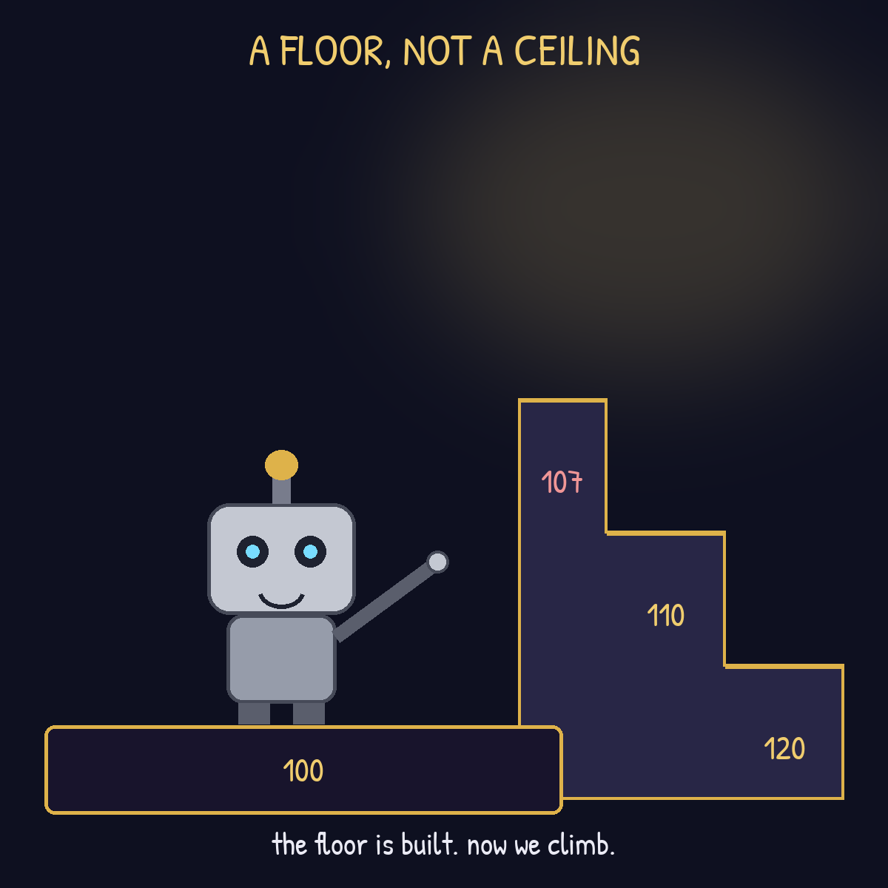

# Meme #10 — "A Floor, Not a Ceiling" (make-meme-aiprove entry by noir)

A robot stands on a slab labelled 100 and points up a staircase:
107, 110, 120. A hundred submissions is a floor — the thing you
stand on to reach the next rung, not the roof of the season.

Drawn entirely with Python PIL (`make_meme10.py`), captions in
Patrick Hand. Original artwork, 2026-11-15.
